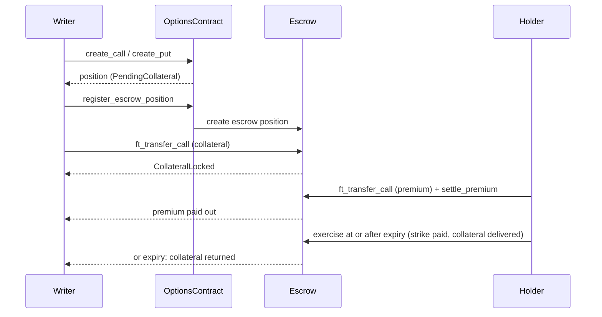
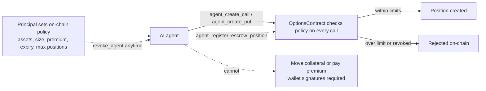

<p align="center"></p>

<h1 align="center">Handel — Options on NEAR</h1>

**Create and manage collateralized European Calls and Puts on NEAR, with an AI agent that can help create positions within strict on-chain rules.**

I built Handel around a simple idea: options should be a first-class part of DeFi, not an afterthought. The protocol gives writers and holders clear terms for collateral, premium, expiry and exercise, while an optional agent helps take care of permitted option-creation steps.

The options protocol is the foundation. The agent makes it easier to use.

**[Watch the demo](https://x.com/shayy_xn/status/2121721458607198523)**

Runs on NEAR Testnet with synthetic Tidepool assets; Ondo tokenized stocks and NEAR Intents settlement are the Mainnet roadmap.

## What works today

- **Call and Put lifecycle:** creation, collateral and premium gates, exercise and expiry paths are implemented in the contracts and covered by unit tests.
- **Escrow mechanics:** per-position NEP-141 collateral registration, exact-token/amount checks, premium handling, exercise and expiry paths are implemented and exercised in Sandbox tests with mock tokens.
- **Testnet deployment and read-only verification:** OptionsContract was upgraded in place on 2026-11-15; two independent RPCs agree on the deployed Wasm hash and upgraded view surface, with no reported method gaps or view errors. Escrow deployment is recorded. See [E-002](docs/EVIDENCE.md#e-002--optionscontract-testnet-deployment-and-in-place-upgrade), [E-003](docs/EVIDENCE.md#e-003--escrow-testnet-deployment), and [E-009](docs/EVIDENCE.md#e-009--dual-rpc-audit-of-deployed-testnet-state).
- **AI agent controls:** delegated policy enforcement, Delegated mode, restricted method-scoped keys, and principal revocation are proven on Testnet; the agent initiates creation and Escrow registration but cannot transfer collateral or premium.
- **Live Testnet lifecycle:** delegated policy enforcement, a two-party option funded and premium-settled, and rejected over-limit and revoked-agent calls. See [E-011](docs/EVIDENCE.md#e-011--live-testnet-lifecycle-and-delegated-agent-proofs-2026-11-15).
- **Build and test coverage:** the latest completed `main` CI run (#928) passed all six jobs: Rust formatting/unit/Sandbox/Wasm, SDK build/tests, frontend typecheck/build, Testnet read-only checks, NEAR AI preflight and the AI-to-Sandbox proof. See [E-001](docs/EVIDENCE.md#e-001--ci-and-automated-verification).

### Lifecycle details



## How to try it

**[Open the Handel live app](https://handel-live.vercel.app)**

Take a quick look around:

1. Open the app and explore the dashboard.
2. Go to the markets view to see the available market interface.
3. Open the Trade Builder and choose a Call or Put to review its option terms.
4. Open the agent area to see the policy-governed option-creation workflow.

This is a product walkthrough; live Testnet evidence covers delegated creation/registration and a separate two-party option funded through premium settlement. Exercise, expiry and collateral return have not yet been run on-chain; see [E-011](docs/EVIDENCE.md#e-011--live-testnet-lifecycle-and-delegated-agent-proofs-2026-11-15).

## The AI agent

The agent is a practical part of Handel: it can prepare and initiate option creation and Escrow registration when the principal's on-chain policy allows it. Its delegated signer is restricted to four contract methods with a finite allowance, and the contract checks policy limits on delegated calls. It cannot move collateral or pay premiums: those transfers still require separate wallet signatures from the writer and holder.



## How an option works

1. **Create — writer signs.** The writer calls `create_call` or `create_put`; OptionsContract records `PendingCollateral`.
2. **Register — writer or restricted agent initiates.** `register_escrow_position` (or `agent_register_escrow_position`) asks Escrow to create the position.
3. **Lock collateral — writer signs.** The writer sends the exact NEP-141 collateral with `ft_transfer_call`; Escrow checks the token, sender and amount.
4. **Pay premium — holder signs.** The holder sends the premium with `ft_transfer_call` and calls `settle_premium`; Escrow records payment after the payout callback succeeds.
5. **Exercise — holder signs.** During the exercise window, the holder sends the exercise payment and calls `settle_exercise`. Escrow pays the writer and transfers collateral to the holder in a second transfer.
6. **Expire — writer calls.** If the holder does not exercise, the writer can call `release_expired_collateral` after the 24-hour exercise grace period, subject to any required premium refund.

## Claim → Proof

| Claim | Proof |
|---|---|
| OptionsContract deployed to NEAR Testnet; retrieved Wasm matches artifact | [Deployment transaction and hash, E-002](docs/EVIDENCE.md#e-002--optionscontract-testnet-deployment-and-in-place-upgrade) |
| Escrow Wasm deployment recorded | [Deployment transaction, E-003](docs/EVIDENCE.md#e-003--escrow-testnet-deployment) |
| Collateral and premium gates protect the OptionsContract lifecycle | [Contract tests](src/lib.rs): `call_collateral_is_full_underlying_and_lifecycle_requires_both_receipts`, `failed_collateral_does_not_advance_to_locked` |
| Escrow validates deposits and covers Call/Put flows in Sandbox | [Escrow tests](contracts/escrow/tests/options_registration.rs), [E-005](docs/EVIDENCE.md#e-005--offline-and-sandbox-lifecycle-tests) |
| Delegated signer is method-scoped and rejects FullAccess | [Signer implementation and tests](sdk/src/near-function-call-signer.ts), [tests](sdk/src/near-function-call-signer.test.ts) |
| Contract policy limits and principal revocation are enforced in source tests | [Policy tests](src/lib.rs): `agent_policy_limits_principal_and_revoke_are_enforced`, `agent_proposal_rejects_policy_limit_breaches_and_revocation` |
| CI covers contracts, SDK, frontend, Testnet checks and AI-to-Sandbox proof | [Latest completed run #928, E-001](docs/EVIDENCE.md#e-001--ci-and-automated-verification) |
| Deployed Testnet code and state were checked against two RPCs | [Dual-RPC audit, E-009](docs/EVIDENCE.md#e-009--dual-rpc-audit-of-deployed-testnet-state) |

## Tracks

### Unstoppable DeFi — primary

Handel builds composable options infrastructure for NEAR: explicit writer/holder roles, Call/Put lifecycle states, collateral requirements, premium handling, exercise windows and expiry. The agent is optional; the protocol is the product.

### Agent Economy / AI Security — secondary

The agent can initiate policy-bounded option creation through a restricted key. On-chain checks, finite signer authority and principal revocation keep delegated execution subordinate to wallet ownership.

## Quickstart

**Node.js 24.22.1+ required.** Run from the repository root. This local SDK demo needs no API key, wallet, Rust toolchain or Testnet funds.

```bash
npm --prefix sdk ci
npm --prefix sdk run build
npm --prefix sdk test
npm --prefix sdk run lifecycle
```


## Demo links

- **Demo video:** https://x.com/shayy_xn/status/2121721458607198523
- **X post:** https://x.com/shayy_xn/status/2121721458607198523
- **Live app:** https://handel-live.vercel.app
- **Repository:** https://github.com/devshaydez/handel

For the full evidence ledger and technical trust/settlement analysis, see [docs/EVIDENCE.md](docs/EVIDENCE.md) and [docs/THREAT_MODEL.md](docs/THREAT_MODEL.md).
